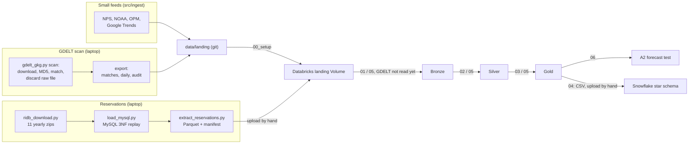

# National Park Demand Signals and a Cloud Lakehouse

Do reservation activity and news coverage help explain or anticipate monthly visits to Yellowstone (YELL),
Yosemite (YOSE), Grand Canyon (GRCA), Zion (ZION) and Great Smoky Mountains (GRSM)? This course project builds a
lakehouse that brings these signals together. It tests each signal against a seasonality-only forecast of National
Park Service (NPS) recreation visits for 2015–2025: 5 parks × 132 months = 660 park-months. The reservation signal
has been tested; news coverage is next.

The plan is in [`docs/Project_proposal.pdf`](docs/Project_proposal.pdf). This README describes the state of the
project at mid-term, 2026-11-15.

## Status at mid-term

| Part | Status | Details |
| --- | --- | --- |
| NPS, NOAA, OPM and Google Trends feeds | Built | Landed in `data/landing/`. They feed Bronze, Silver and Gold in Databricks |
| GDELT 2.0 GKG archive scan, the dataset for the course's 5 TB rule | Built, full archive scanned | 403,565 files, 2,888.87 GB zipped and 9,057.21 GB decompressed, 735,225,688 records, 636,731 park matches |
| GDELT tables in the lakehouse | Built | `07_gdelt_news` ran on Databricks on 2026-11-17 with every gate passing: `gold_month_gkg` (132 rows) and `gold_park_month_news` (660 rows, news_all 612,919, news_url 174,604). `tests/check_gdelt_gold.py` recomputes both exports from `data/landing` without Spark: MATCH, largest difference 0 |
| Reservations in MySQL (3NF) | Built | FY2015–FY2025: 7,586,234 reservations and 7,243,035 orders. The reconciliation difference is 0 in all 55 (fiscal year, park) rows |
| Incremental extract, MySQL to Parquet | Built | One full pull of 7,586,234 rows. A second run found no new or changed rows |
| Databricks Bronze, Silver and Gold | Built | Notebooks 00–06, run by hand from a Databricks Git folder |
| Snowflake star schema | Built | `DIM_PARK`, `DIM_MONTH` and `FACT_PARK_MONTH`, loaded from `gold_park_month`; `FACT_PARK_MONTH_RESERVATIONS`, loaded from `gold_park_month_reservations`. All 11 checks of `05_checks_reservations.sql` pass, and a rerun of the MERGE changes 0 rows |
| Week 8 test A1 (GDELT) | 3 of 4 conditions met | Precision is 34 of 100. Part 2, a pre-registered check of the URL rule on 200 fresh matches, is not met: P = 0.5022 against the bar 0.90, and all five parks are below the bar. 86 of the 200 rows, whose pages showed no text, count as 0. See [`a1_part2_result.md`](docs/week8/a1_part2_result.md) |
| Week 8 test A2 (reservations) | Passed | Part 1: the load checks pass. Part 2: in a pre-registered forecast test, reservations lowered held-out error in 3 of 5 parks, the minimum the proposal set |
| Dashboard, scheduled job | Not built yet | See [Next steps](#next-steps) |
| CI with GitHub Actions | Passing | `.github/workflows/ci.yml`, see [CI](#ci). Both jobs passed on GitHub in runs #1 to #3 (commits e8d79ec, 7288c47, 4017558) |

## Data

| Dataset | What is used | In this repo | Rights |
| --- | --- | --- | --- |
| [NPS visitor use statistics](https://irma.nps.gov/Stats/) | Monthly recreation visits per park, 2015-01 to 2025-12: 660 park-months | `data/landing/nps_visitation/` | Public domain |
| [NOAA Global Summary of the Month](https://www.ncei.noaa.gov/support/access-data-service-api-user-documentation) | Monthly temperature, precipitation and snow from 10 stations, two per park: 1,345 station-months | `data/landing/noaa_weather/` | Public domain |
| [OPM federal holidays](https://www.opm.gov/policy-data-oversight/pay-leave/federal-holidays/) | Holiday tables 2015–2030: 172 rows | `data/landing/federal_holidays/` | Public domain |
| Google Trends, through `pytrends` | US monthly search interest per park topic, 2015-01 to 2025-12: 132 months | `data/landing/google_trends/` | Google Terms of Service; cite Google Trends ([help page](https://support.google.com/trends/answer/4365538)) |
| [GDELT 2.0 Global Knowledge Graph](https://www.gdeltproject.org/) | News records that name one of the parks, and all records per day as a denominator | `data/landing/gdelt_*` | Free for any use with citation |
| [Recreation.gov reservations (RIDB)](https://ridb.recreation.gov/download) | Historical reservation files FY2015–FY2025 | Aggregates only, in `docs/week8/` | RIDB API Access Agreement; aggregates only |

Data sources: news data from the GDELT Project (https://www.gdeltproject.org/). Reservation data from the Recreation
Information Database (RIDB), Recreation.gov. Search interest from Google Trends (https://www.google.com/trends).

Row-level reservations never enter git. They stay in MySQL, in the git-ignored `data/work/`, in the Databricks
landing Volume and in the Bronze and Silver reservation tables. Only aggregates are committed: counts per park-month,
campground-month and (fiscal year, park), NPS visits, model coefficients, forecasts, errors and check outputs.

## Architecture as built



The numbers on the arrows are the Databricks notebooks, `00_setup` to `06_forecast_test`.

How the build differs from the proposal:
- **Gold to Snowflake** goes as one CSV file, downloaded and uploaded by hand, not as a Parquet load.
- **The reservation watermark** is the reservation key for new rows, plus `updated_at` for changed rows, not the
  order time. A later fiscal-year file adds older orders, so order time cannot mark what is new.
- **The GDELT filter** is a resumable batch scan of the whole archive, not a stream of new 15-minute files.
- **MySQL** holds all eleven fiscal years. The proposal's Week 8 test loaded only FY2017 and FY2024, and the A2
  signal is computed from MySQL rather than from the files.
- **The A2 signal** counts only camping reservations on the books at the start of the month; the proposal says
  reservations. Camping is the only reservation family found in every file FY2015–FY2025 for GRCA, GRSM, YOSE and
  ZION. Counting all reservation types instead (secondary check S4), the reservations lower the error in 1 of 5
  parks.
- **Google Trends** search interest is a fourth small feed. The proposal does not list it.
- **The scanned archive** has 403,694 listed files rather than 402,046, because it runs through 2026-11-08.

## What each part does

### Small feeds
`src/ingest/parks.py` holds the five parks, their NOAA station pairs and their Google Trends topics. Each feed
script saves the values as received, without cleaning, to `data/landing/<source>/pull_date=YYYY-MM-DD/`:
- `nps_visitation.py`: the NPS IRMA API, one JSON file per park;
- `noaa_weather.py`: NOAA GSOM, one JSON file per station;
- `federal_holidays.py`: the OPM holiday tables, one CSV file;
- `google_trends.py`: Google Trends, one CSV file.

### GDELT scan
`src/ingest/gdelt_gkg.py` processes each 15-minute GKG file in a date range.
- It downloads the file, checks its MD5 against the master list, and unzips it in memory.
- It keeps the records that name a park, counts all records per day, writes one audit row per file to a local
  SQLite database, and discards the file. A stopped scan resumes where it left off.
- The full scan covered the files listed from 2015-02-18 to 2026-11-08, on one laptop. The first pass took 24.5
  hours at 32.7 MB/s, and one rerun retried the 129 files that had not passed.
- Of 403,694 listed files, 403,565 passed. 128 are missing on the server and 1 fails its MD5 check.
- Matches per park: YELL 280,730, YOSE 184,569, GRSM 60,776, GRCA 59,948, ZION 50,708.
- The exports are in `data/landing/gdelt_matches`, `gdelt_daily` and `gdelt_audit`. The runbook is
  [`docs/gdelt_scan.md`](docs/gdelt_scan.md).

### Reservations: MySQL and the extract
- `src/ingest/ridb_download.py` downloads the RIDB yearly zips.
- `mysql/01_schema.sql` defines 8 InnoDB tables in third normal form, with primary keys, foreign keys and CHECK
  constraints.
- `src/load_mysql.py` streams each zip and keeps the rows of the five parks. It merges the two file layouts into one.
  It replays each fiscal-year file's bookings in order-time order, oldest file first, as idempotent upsert
  transactions. Invalid rows go to a rejects file.
- `mysql/02_checks.sql` reconciles every (fiscal year, park) with the source counts, and checks orphans, duplicates
  and constraints.
  - The FY2015–FY2025 load read 66,730,835 CSV rows and stored 7,586,234 reservations.
  - Every check is 0, and a rerun of all eleven years inserted or changed 0 orders and 0 reservations.
- `src/extract_reservations.py` reads MySQL in one read-only snapshot.
  - It writes typed Parquet files and a `_manifest.json` with the watermarks and counts.
  - It publishes the pull folder only after the rows written equal MySQL's counts.

### Databricks lakehouse
The notebooks run in order from a Databricks Git folder of this repo, in catalog `workspace`, schema `nps_tourism`.

| Notebook | Builds |
| --- | --- |
| `00_setup` | The schema, the `landing` Volume, and a copy of `data/landing/` into the Volume |
| `01_bronze` | `bronze_nps_visitation`, `bronze_weather`, `bronze_holidays`, `bronze_search_trends`: raw strings, with the pull date, source file and load time |
| `02_silver` | Typed, deduplicated tables, ending in `silver_park_month`: 660 rows of visits, weather, holidays and search interest |
| `03_gold` | `gold_park_month`: 660 rows, 24 columns, adding park names, year-over-year change, a rolling 12-month total and each month's share of the year |
| `04_export_gold` | `gold_park_month.csv` in the `exports` Volume, checked by reading it back |
| `05_reservations` | `bronze_ridb_reservations`, `silver_reservations` (7,586,234 rows), `gold_facility_month_reservations` and `gold_park_month_reservations` (660 rows), with row-count gates against the manifest |
| `06_forecast_test` | The A2 part 2 test: `a2_forecast_summary` (65 rows) and `a2_forecast_monthly` (645 rows) |

05 and 06 need the private reservation pull, uploaded by hand to `landing/ridb_reservations/`.

### Snowflake star schema
- `snowflake/01_setup.sql` creates warehouse `CLASS_WH`, database `NPS_TOURISM`, schemas `STAGING` and `DW`, a CSV
  file format and a stage.
- `snowflake/02_load_star.sql` copies the Gold CSV into staging and MERGEs it into the star. Rerunning it with the
  same file inserts and updates 0 rows.
  - `DIM_PARK` has 5 rows. `DIM_MONTH` has 132, with the calendar columns (days, weekend days, holidays).
  - `FACT_PARK_MONTH` has 660 rows, one per park and month: five visit measures, search interest, five weather
    measures and a backup-station flag.
- `snowflake/03_checks.sql` is read-only. It runs 11 PASS/FAIL checks, a column-by-column comparison with staging,
  and two business queries.
- `snowflake/04_load_reservations.sql` loads `gold_park_month_reservations.csv` into a second fact,
  `FACT_PARK_MONTH_RESERVATIONS`, at the same park x month grain. `05_checks_reservations.sql` is read-only: 11
  PASS/FAIL checks, a column-by-column comparison with staging, totals, and a query across the two facts.

The model is in [`docs/star_schema.md`](docs/star_schema.md).

## Week 8 tests

The proposal named the project's two riskiest assumptions and a test for each.

**A1: the full GDELT archive can be scanned on schedule and matched precisely.** Details are in
[`docs/week8/a1_gdelt_test.md`](docs/week8/a1_gdelt_test.md).

| Pass condition | Result |
| --- | --- |
| Every checksum verifies | Met: 672 of 672 files in the test week (2025-01-06 to 2025-01-12) |
| A rerun reproduces the counts | Met: 914,630 records and 388 matches, 0 differences |
| The projected full scan takes 7 days or less | Met: projected 26 hours at 30.9 MB/s; the full scan took 24.5 hours |
| At least 90% of checked matches are about the park | **Not met: 34 of 100.** The park name often appears in articles about something else: syndicated stories reprinted many times, travel lists, and the TV series *Yellowstone* |

A refined rule requires the park name in the article's URL path. On the same 100 labels it keeps 28 matches, 27 of
them about the park, and drops 7 of the 34 relevant matches. The rule was chosen after seeing these labels, so part 2
checked it on fresh matches.

**A1 part 2: not met.** The rule, frozen as R0 in `src/gdelt_url_rule.py`, was checked on 200 random matches that
pass it, 40 per park, under rules committed before the sample was drawn. The rules are in
[`a1_part2_spec.md`](docs/week8/a1_part2_spec.md) and the result in
[`a1_part2_result.md`](docs/week8/a1_part2_result.md).
- The weighted precision is P = 0.5022 (95% interval 0.4080-0.5964), against the bar 0.90. A1's fourth condition
  stays not met, and R0 is not changed.
- Every park is below the per-park bar of at least 33 of 40: GRCA 22, GRSM 19, YELL 22, YOSE 25 and ZION 17 of 40.
- 114 rows were labeled from the article content. For the other 86, neither the article nor its archive copy
  showed the text, and they were set to 0 without being read; P counts them as 0. Without them, P is 0.9004 over the
  114 read rows, which are not a random subset of the sample. Neither number is the precision of the matches that
  pass the rule.
- The news forecast test will mark its result below the bar, for the pooled precision and for all five parks.

**A2: reservations are usable leading signals.** Details are in
[`docs/week8/a2_mysql_test.md`](docs/week8/a2_mysql_test.md), [`a2_part2_spec.md`](docs/week8/a2_part2_spec.md)
and [`a2_part2_result.md`](docs/week8/a2_part2_result.md).
- **Part 1 passed.** FY2017 and FY2024 were loaded into MySQL with 79 facilities mapped to the five parks. The
  reconciliation difference is 0 in all 10 (fiscal year, park) rows, and the 17 key checks are 0. All eleven years
  were then loaded with the same result in 55 rows.
- **Part 2 passed: R is lower in 3 of 5 parks, the minimum the proposal set.**
  - Two forecasts were compared. B is a seasonal baseline. R adjusts B by the camping reservations on the books at
    the start of each month. Both were scored by MAPE (mean absolute percentage error; lower is better).
  - Training ran from 2015 to 2023 without the 2020 closures. The held-out months are 2024-01 to 2025-09.
  - The rules and code were committed before the reservations were extracted from MySQL. Some 2024–2025 visit
    summaries, including GRCA's July–September 2025 visits, had been seen before the rules were fixed. The spec lists
    them, and no rule uses them.
  - R has the lower MAPE in GRCA (15.89 against 16.39), YOSE (8.06 against 8.19) and ZION (10.12 against 12.40).
  - R does not have the lower MAPE in GRSM (13.09 against 12.39) or YELL (21.93 against 16.97).
  - Of the three parks where R is lower, only ZION's reservation effect is more than twice its standard error. GRCA's
    margin comes from July to September 2025, and YOSE's margin is 0.13 points.
  - A seasonal baseline with a post-2020 level (secondary check S6) has a lower MAPE than R in GRCA (11.93), YELL
    (7.92) and ZION (9.19).

## Repository layout

```
data/landing/            raw feed files and GDELT exports, one pull_date= folder per pull (committed)
data/work/               private local data: RIDB zips, Parquet pulls, GDELT scan database (git-ignored)
databricks/notebooks/    00_setup ... 06_forecast_test
docs/                    proposal, GDELT runbook, star schema, Week 8 test results (docs/week8),
                         superseded proposal drafts (docs/archive)
mysql/                   01_schema.sql, 02_checks.sql
snowflake/               01_setup.sql, 02_load_star.sql, 03_checks.sql, 04_load_reservations.sql, 05_checks_reservations.sql
src/ingest/              feed scripts, GDELT scan worker, RIDB downloader
src/                     load_mysql.py, extract_reservations.py, a2_forecast.py
```

## How to run

Python 3.12 with [uv](https://docs.astral.sh/uv/). From the repository root:

```
uv sync
```

Small feeds (each writes a new `pull_date=` folder):

```
uv run python src/ingest/nps_visitation.py
uv run python src/ingest/noaa_weather.py
uv run python src/ingest/federal_holidays.py
uv run python src/ingest/google_trends.py
```

GDELT scan, export and precision sample (see `docs/gdelt_scan.md` for the shard dates):

```
uv run python src/ingest/gdelt_gkg.py scan --start 2015-02-18 --end 2026-11-08 --workers 6
uv run python src/ingest/gdelt_gkg.py status
uv run python src/ingest/gdelt_gkg.py export --start 2017-03-01 --end 2019-06-30 --shard s2
uv run python src/ingest/gdelt_gkg.py sample --n 100
```

Shard s1 (2015-02-18 to 2017-02-28) needs `--allow-incomplete` on `export`, because one file fails its MD5 check.

Reservations. The loader and the extract read `MYSQL_URL` from a local `.env` file, which is not committed. The
loader writes to the database named there; the extract reads the database given by `--database`:

```
uv run python src/ingest/ridb_download.py --fiscal-years 2015 2016 2017 2018 2019 2020 2021 2022 2023 2024 2025
uv run python src/load_mysql.py --fiscal-years 2015 2016 2017 2018 2019 2020 2021 2022 2023 2024 2025
mysql -u <user> -p <database> --table < mysql/02_checks.sql
uv run python src/extract_reservations.py --database <database>
```

Databricks:
1. Create a Git folder from this repository.
2. Run `00_setup`, `01_bronze`, `02_silver`, `03_gold` and `04_export_gold` in order, each with Run all.
3. For the reservation tables, upload a `pull_date=` folder from `data/work/landing/ridb_reservations/` to
   `/Volumes/workspace/nps_tourism/landing/ridb_reservations/`. Then run `05_reservations` and `06_forecast_test`.

Snowflake:
1. Run `snowflake/01_setup.sql` in a Snowsight worksheet.
2. Upload `gold_park_month.csv` from the Databricks `exports` Volume to `NPS_TOURISM.STAGING.NPS_STAGE`.
3. Run `02_load_star.sql`, then `03_checks.sql`, one statement at a time.
4. Upload `docs/week8/a2_inputs/gold_park_month_reservations.csv` to the same stage, then run
   `04_load_reservations.sql` and `05_checks_reservations.sql`, one statement at a time.

The A2 part 2 test can be rerun without the private data, from the committed aggregates:

```
uv run python src/a2_forecast.py --park-month docs/week8/a2_inputs/a2_inputs_park_month.csv --camping-facility-month docs/week8/a2_inputs/gold_facility_month_camping.csv --out <folder>
uv run python tests/check_a2_rerun.py --summary <folder>/a2_forecast_summary.csv --monthly <folder>/a2_forecast_monthly.csv
```

`tests/check_a2_rerun.py` compares the two written files with the committed outputs of 06 and states the verdict.

## CI

`.github/workflows/ci.yml` runs on GitHub Actions on every push and pull request to `main`. It uses only committed
files: no secrets, no private data, and no network beyond installing Python, Java and packages. Two jobs run on
`ubuntu-latest`:
- `offline-checks`, Python 3.12 with `uv.lock` (`uv sync --locked`):
  - compiles every `.py` file in `src`, `tests` and `databricks`;
  - runs the `src/gdelt_url_rule.py` self-tests and `src/gdelt_sample.py check` (never `draw`, `score` or
    `check-labels`);
  - reruns the A2 part 2 test from `docs/week8/a2_inputs/` and compares it with the committed outputs, with
    `tests/check_a2_rerun.py`.
- `notebook-07-local`, Java 21 with PySpark 4.3.0: runs `07_gdelt_news` on local Spark with
  `tests/run_notebook_local.py`, then checks its two exports with `tests/check_gdelt_gold.py`.

To see the results, open the repository on GitHub and click the **Actions** tab, then the **CI** workflow. Each run
lists both jobs, with the log of every step. A pull request shows the same jobs under its checks.

## Next steps

The final deadline is December 11, 2026.

| Week | Work |
| --- | --- |
| Nov 16–22 | Apply the URL rule to the matched URLs, which needs no rescan, and label a fresh sample to check its precision. Build GDELT Bronze, Silver and Gold tables: news per park-month |
| Nov 23–29 | Add news coverage to the forecast comparison, as the proposal plans after the full scan. Count it as a share of all GKG records per month, because GDELT has no files from 2025-06-15 to 2025-07-01. Load the news fact into Snowflake (the reservation fact is loaded) |
| Nov 30–Dec 6 | Run the notebooks as one Databricks Job, with data quality checks that fail the run. Build a dashboard on the star schema |
| Dec 7–11 | The final report and presentation |
