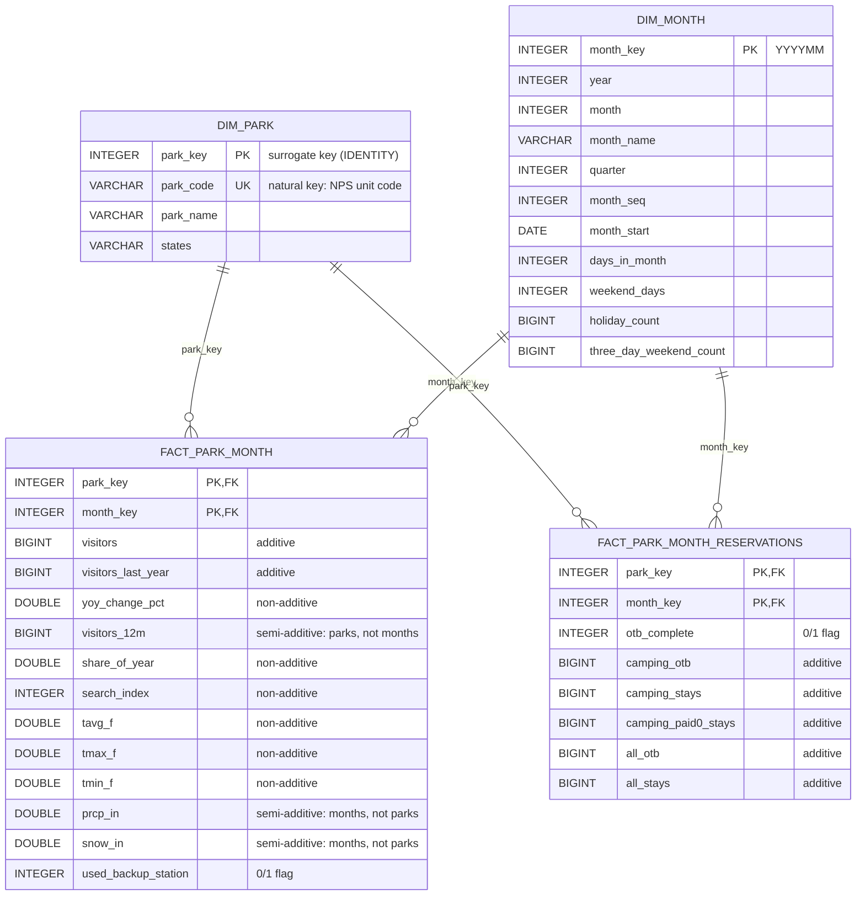

# Snowflake star schema

Databricks Gold (`gold_park_month`, 660 rows) is exported by `databricks/notebooks/04_export_gold.py`, uploaded to the
Snowflake stage `NPS_TOURISM.STAGING.NPS_STAGE`, and loaded by `snowflake/01_setup.sql`, `02_load_star.sql` and
`03_checks.sql` into the star schema `NPS_TOURISM.DW`. Loads are MERGE statements, so a rerun changes nothing.

The reservation counts (`gold_park_month_reservations`, 660 rows, from `databricks/notebooks/05_reservations.py`;
committed as `docs/week8/a2_inputs/gold_park_month_reservations.csv`) are loaded by
`snowflake/04_load_reservations.sql` into a second fact, `DW.FACT_PARK_MONTH_RESERVATIONS`, and checked by
`05_checks_reservations.sql`. Run 02 before 04: the second fact takes `park_key` from `DIM_PARK`, and its
`month_key` values must be in `DIM_MONTH`.

## Model

- `DW.DIM_PARK`: grain is one row per national park. Type 1: changes are overwritten in place.
  - `park_key` is the surrogate key (IDENTITY). `park_code` is the natural key.
  - Other columns: `park_name`, `states`.
- `DW.DIM_MONTH`: grain is one row per calendar month. Type 1: changes are overwritten in place. `month_key` is the key.
  - Other columns: `year`, `month`, `month_name`, `quarter`, `month_seq`, `month_start`, `days_in_month`,
    `weekend_days`, `holiday_count`, `three_day_weekend_count`.
- `DW.FACT_PARK_MONTH`: grain is one row per park x month. Keys are `park_key` and `month_key`.
  - Additive (sums over parks and months): `visitors`, `visitors_last_year`.
  - Semi-additive: `visitors_12m` sums over parks, not months. `prcp_in` and `snow_in` sum over months, not parks.
  - Non-additive (do not sum): `yoy_change_pct`, `share_of_year`, `search_index`, `tavg_f`, `tmax_f`, `tmin_f`.
  - Flag: `used_backup_station`, 1 = `tavg_f`, `tmax_f` and `tmin_f` come from the park's backup station.
  - `visitors_last_year`, `yoy_change_pct`, `visitors_12m` and `share_of_year` are computed from `visitors` in
    Databricks Gold and stored, so the star holds every Gold column.
- All 24 Gold columns are in the star. Check 2 joins the star back into the Gold layout and finds no difference from staging.

- `DW.FACT_PARK_MONTH_RESERVATIONS`: grain is one row per park x month, the grain and keys of `FACT_PARK_MONTH`, so
  the two facts join 1:1 through `DIM_PARK` and `DIM_MONTH`. Keys are `park_key` and `month_key`.
  - A reservation counts once, in the month its stay starts. On the books (`_otb`) = ordered before 00:00 UTC on
    day 1 of that month. Counts are gross: the source files have no cancellation status.
  - Additive (sums over parks and months): `camping_otb`, `camping_stays`, `camping_paid0_stays`, `all_otb`,
    `all_stays`. Each reservation is in exactly one park and one month.
  - Flag: `otb_complete`, 1 = `camping_otb` holds every booking made before day 1 (523 of 660 rows; YELL from
    2022-03, the other parks from 2015-10, all through 2025-09).
  - The five counts are NULL in 2025-10..2025-12 (15 rows): those stays are in the FY2026 file, not published yet.
  - Check 2 of `05_checks_reservations.sql` joins the fact back into the CSV layout and finds no difference from
    staging. Query 5 is a drill-across: visits and camping bookings per park in 2024, each fact summed on its own and
    then joined.
