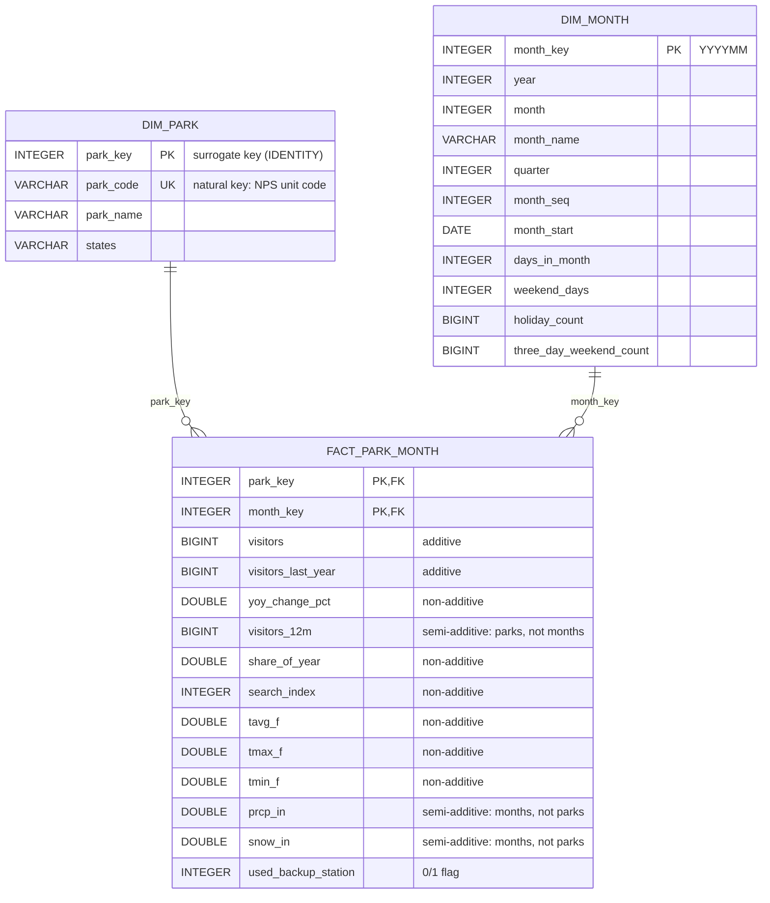

# Snowflake star schema

Databricks Gold (`gold_park_month`, 660 rows) is exported by `databricks/notebooks/04_export_gold.py`, uploaded to the
Snowflake stage `NPS_TOURISM.STAGING.NPS_STAGE`, and loaded by `snowflake/01_setup.sql`, `02_load_star.sql` and
`03_checks.sql` into the star schema `NPS_TOURISM.DW`. Loads are MERGE statements, so a rerun changes nothing.

## Model

- `DW.DIM_PARK`: grain is one row per national park. Type 1: changes are overwritten in place.
  - `park_key` is the surrogate key (IDENTITY). `park_code` is the natural key.
  - Other columns: `park_name`, `states`.
- `DW.DIM_MONTH`: grain is one row per calendar month. Type 1: changes are overwritten in place. `month_key` is the key.
  - Other columns: `year`, `month`, `month_name`, `quarter`, `month_seq`, `month_start`, `days_in_month`,
    `weekend_days`, `holiday_count`, `three_day_weekend_count`.
- `DW.FACT_PARK_MONTH`: grain is one row per park x month. Keys are `park_key` and `month_key`.
  - Additive (sums over parks and months): `visitors`, `visitors_last_year`.
  - Semi-additive: `visitors_12m` sums over parks, not months. `prcp_in` and `snow_in` sum over months, not parks.
  - Non-additive (do not sum): `yoy_change_pct`, `share_of_year`, `search_index`, `tavg_f`, `tmax_f`, `tmin_f`.
  - Flag: `used_backup_station`, 1 = `tavg_f`, `tmax_f` and `tmin_f` come from the park's backup station.
  - `visitors_last_year`, `yoy_change_pct`, `visitors_12m` and `share_of_year` are computed from `visitors` in
    Databricks Gold and stored, so the star holds every Gold column.
- All 24 Gold columns are in the star. Check 2 joins the star back into the Gold layout and finds no difference from staging.

